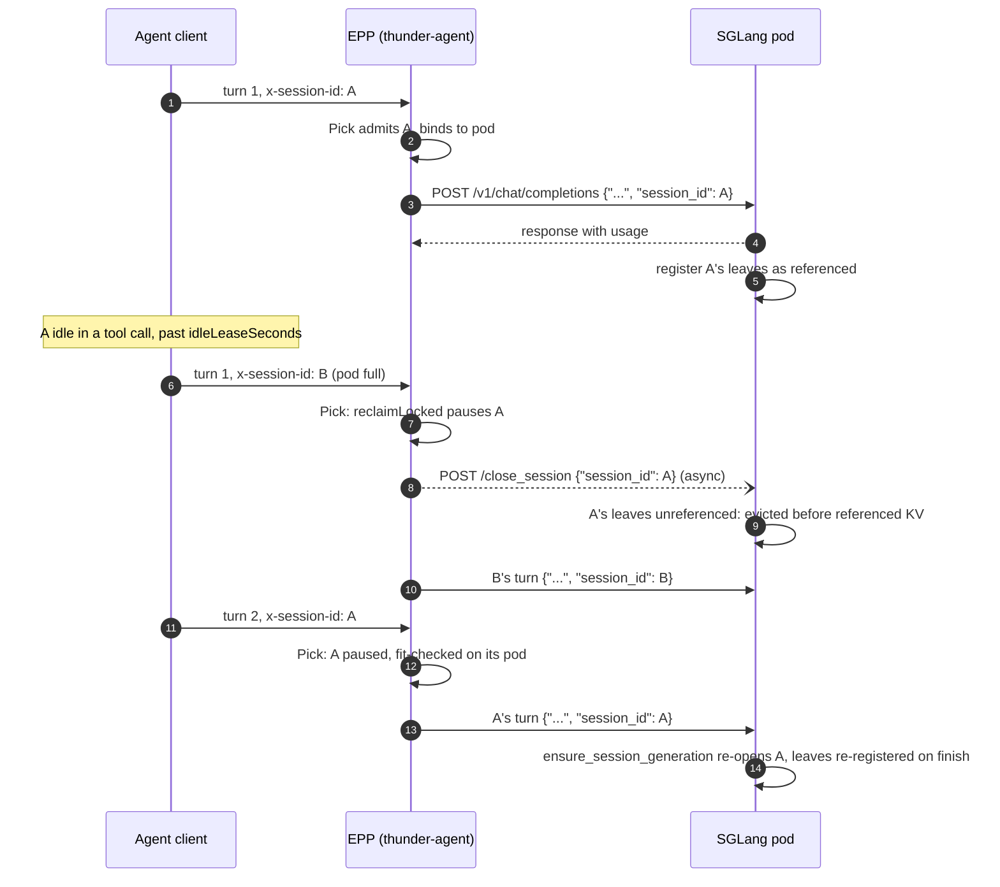
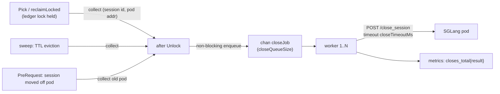

# Thunder-agent: make pauses visible to the engine with SGLang session references

> [!IMPORTANT]
> **Problem.** The thunder-agent gate pauses an idle session to give its KV room to another turn, and the ledger stops counting it, but the engine is never told. The engine's LRU decides on its own which blocks go, so a paused session's prefix can outlive an admitted session's, and KV of sessions that will never return (finished, TTL-evicted) is kept while it is recent.
> **Proposal.** Carry the agent-identity session id as the top-level `session_id` on every tracked request to SGLang pods, and `POST /close_session` from the EPP at the ledger's release points (pause, TTL eviction, move off a pod). With `--enable-session-radix-cache`, SGLang evicts unreferenced KV first, so the engine's eviction order follows the router's admission decisions. No request is ever aborted by a close; a session re-opens itself on its next turn.
> **Scope.** One plugin config block, one bounded async closer, one director-level body rewrite modelled on the existing priority rewrite. SGLang only; vLLM has no equivalent API.

[TOC]

## 1. Background

### 1.1 What the router does today

On branch `thunder-agent-forced-reclaim`, `Pick` is the admission gate. When a picked turn does not fit its pod, `reclaimLocked` (`pkg/epp/framework/plugins/thunderagent/manager.go`) walks the pod's sessions that are idle past `idleLeaseSeconds`, longest idle first, and sets `paused = true` until the freed room covers the need. A paused session's `footprint` is 0, so the ledger treats its KV room as free. Its next turn is fit-checked again and resumes onto its own pod when room exists (`PreRequest` clears `paused`).

The pause is a ledger-only event. Measured on the verification pool (`thunderagent-original-verification/13-llm-d-router-sweep`), a paused session's prefix survives 10 to 12 s on its pod at c=128 before LRU takes it, and that horizon is set by the engine, not by the router.

### 1.2 What SGLang offers

`--enable-session-radix-cache` (implemented only by `UnifiedRadixCache`; `python/sglang/srt/arg_groups/fields/memory.py`) adds a session reference tracker to the radix tree:

| Mechanism | Behavior | Code |
|---|---|---|
| Top-level `session_id` on a request | Accepted by `/generate`, `/v1/completions`, `/v1/chat/completions`, `/v1/responses`. Labels cache references only; does not alter or reconstruct the prompt. Ignored when the flag is off. | `managers/io_struct.py` (`GenerateReqInput.session_id`), `entrypoints/openai/protocol.py` |
| Register on finish | When a request finishes (not aborted), each tree component (full, SWA, Mamba) increments `session_ref` along the reusable path to the request's leaf and records `session_id` on the leaf. | `mem_cache/unified_radix_cache.py` `insert_req`; `unified_cache/session_ref_tracker.py` `register_session_ref` |
| Eviction order | Full attention sorts evictable leaves by `(session_ref > 0, session_ref, lru_priority)`: unreferenced nodes (`session_ref == 0`) go first, then nodes with fewer session references, then LRU (`components/full.py` `_session_ref_eviction_strategy`). SWA and Mamba run two LRU passes (unreferenced, then referenced). Device and host eviction share the preference. | `unified_cache/components/full.py`, `base.py` `_can_evict_leaf_atomically` |
| `POST /close_session {"session_id"}` | Decrements `session_ref` along the session's registered leaves (`session_ref` drops to 0 if unshared) and records a tombstone. The KV stays reusable in the tree. No request is aborted: with the flag on, the request-level `SessionController.close` runs only for sessions opened through `session_params`. | `managers/scheduler.py` `close_session`; `session_ref_tracker.py` `release_radix_session` |
| Implicit re-open | The next request carrying the same `session_id` calls `ensure_session_generation`, which clears the tombstone and starts a new generation. No `/open_session` is needed. | `managers/scheduler.py` request routing |
| Soft protection vs `lock_ref` | `lock_ref` pins nodes of requests currently executing a forward pass; `session_ref` orders unlocked (`lock_ref == 0`) nodes for eviction. Referenced KV is still evicted when unreferenced KV is insufficient, so references cannot deadlock admission. | `docs/docs/advanced_features/session_radix_cache.mdx` |

`UnifiedRadixCache` is the default tree cache in SGLang (`mem_cache/registry.py` `default_radix_cache_factory`), covering standard full-attention models, MLA models (GLM-5.2, DeepSeek), and hybrid linear-attention / Mamba models (GLM-5-Next, Qwen3-Next). A reference has no TTL on the engine side: it is removed only by `/close_session` or when its node is evicted. Closing at every router-side release point is therefore required to avoid leaving stale protection on departed sessions.

### 1.3 Where engine LRU and the router diverge

Within a single session's branch, SGLang evicts from leaf toward root (`last_access_time` is refreshed along the matched prefix on each request, so a leaf and its newly exposed parent share the session's last-turn timestamp). Across sessions, vanilla LRU orders strictly by that last-turn timestamp. The router's decisions diverge from last-turn timestamp in five cases:

| Case | Router decision | Engine with LRU alone | Engine with `session_id` + `/close_session` |
|---|---|---|---|
| **1. Queued turn skipped by `reclaimLocked`** | `idleSessionsLocked` skips any session with a turn already waiting in the EPP queue (`!queued[id]`), even if its idle time is the longest on the pod, and pauses a more recently active session whose next turn has not arrived. | The queued session has the oldest `last_access_time` on the pod. When an earlier-dispatched turn allocates KV, LRU evicts the queued session's tail milliseconds before that session dispatches, while keeping the paused session's KV. | Pausing calls `/close_session`, dropping the paused session to `session_ref = 0`. The queued session stays at `session_ref = 1` and keeps its prefix while waiting in the EPP queue. |
| **2. Multi-request decode batch growing KV** | While a batch of admitted requests decodes on the GPU (`lock_ref > 0`), other admitted sessions wait in tool calls or in the EPP queue (`lock_ref == 0`), alongside sessions the router has already paused. | Every decode step allocates pages by popping the oldest unlocked leaves from tail to root. Any admitted session whose last completed turn predates a paused session (for example, because it waited in the EPP queue behind smaller admitted turns) is eaten from tail to root before the paused session is touched. | Paused sessions have `session_ref = 0`. The decoding batch drains all paused sessions' leaves from tail to root before touching any admitted session (`session_ref >= 1`). |
| **3. Size-based (smallest-first) pause policy** | Upstream ThunderAgent (`_pause_until_safe` and `origin/thunder-agent`) pauses the smallest idle session first so that, if eviction happens, an 8k session is recomputed instead of an 80k session. `thunder-agent-forced-reclaim` had to switch to longest-idle-first because the engine ignored who was paused. | Pausing an 8k session that finished 15 s ago does not stop LRU from evicting an 80k session that finished 25 s ago: the 8k session is held at the gate and the 80k session loses its KV. | Closing the paused 8k session sets its `session_ref` to 0, so the engine evicts the 8k session regardless of age and preserves the 80k session. |
| **4. Finished, moved, or anonymous requests** | A session that finished its trajectory, aged past `evictionTtlSeconds`, or moved to another pod will never reuse its KV on the old pod; anonymous requests carry no session identity. | A finished session or one-shot request completed seconds ago has the freshest timestamp on the pod, so its dead KV outlives admitted sessions in 20–40 s tool calls. | Closed on release (or never given a `session_id`), so `session_ref == 0` and its KV is reclaimed ahead of all active sessions. |
| **5. Parent and sub-agents sharing a prefix** | Parallel sub-agents run under distinct session ids while sharing a long repository/system prefix with the parent trajectory. | Shared trunk nodes carry a single `last_access_time`; if all branches are in tool calls at once, the trunk is treated like any single-session branch. | Trunk nodes accumulate `session_ref = k` across the `k` live sessions, ranking above single-session leaves (`session_ref = 1`) even if unreferenced space runs out. Closing each sub-agent on completion decrements `k` back down. |

<details><summary><strong>Worked timeline for Case 1 (queued-turn inversion in <code>reclaimLocked</code>)</strong></summary>

Pod capacity is 100k tokens, `idleLeaseSeconds = 30`.

1. `t = 0 s`: Session A (45k) finishes turn 1 and starts a 35 s tool call.
2. `t = 4 s`: Session B (45k) finishes turn 1 and starts a 60 s tool call.
3. `t = 34 s`: Session C (10k) finishes turn 1.
4. `t = 35 s`: Both A's turn 2 (45k) and C's turn 2 (grows to 25k) arrive at the EPP. Both are `classAdmitted`; `betterThan` orders admitted sessions smallest-first (`fairness.go`), so `Pick` selects C first.
5. C's 15k growth pushes the pod to 115k > 100k. `admitLocked` calls `reclaimLocked` for 15k:
   - A has been idle 35 s (>= 30 s lease), but `queued[A] == true`, so `idleSessionsLocked` skips A.
   - B has been idle 31 s (>= 30 s lease) and `queued[B] == false`, so `reclaimLocked` sets `B.paused = true`.
6. C is forwarded to SGLang and allocates 15k tokens:
   - **Without `/close_session`**: SGLang sees `A.last_access_time = 0` and `B.last_access_time = 4`. It evicts 15k from the tail of **A** and keeps **B**. On the next `Pick` cycle a few milliseconds later, A dispatches and pays a 15k re-prefill.
   - **With `/close_session`**: Pausing B sends `/close_session(B)`, setting B's nodes to `session_ref = 0` while A stays at `session_ref = 1`. SGLang evicts 15k from **B**, and A's queued turn hits its full 45k cache.

</details>

## 2. Goals and non-goals

**Goals**

- Every request of a tracked session reaching an SGLang pod carries a router-owned top-level `session_id`.
- Every ledger release point issues `/close_session` to the pod that holds the session's KV, off the dispatch path and off the ledger lock.
- The feature is opt-in, defaults off, and is a no-op against engines that lack the flag.
- The gate, the scorer and the accounting are unchanged.

**Non-goals**

- Changing SGLang. The feature uses the API as shipped.
- vLLM support. vLLM has no session reference API; the design leaves a seam (engine selection by label) and nothing else.
- Replacing the EPP-side ledger with engine state. The ledger remains the admission authority; the engine is told its decisions.
- Hard pinning of admitted sessions' KV. SGLang references are soft by design and this doc keeps them soft.
- Prefill/decode disaggregation. thunder-agent already logs that it does not support it.
- `/v1/responses`. SGLang accepts `session_id` there, but the first change covers `/v1/chat/completions`, `/v1/completions` and `/generate` only.
- Closing on the pod-leave path. A pod that left the endpoint list is treated as gone; no drain signal exists to tell a reachable pod apart.

## 3. Design

### 3.1 End-to-end



Two additions carry the whole feature: a body rewrite on the request path (3.2) and an asynchronous closer on the release path (3.3).

### 3.2 Request path: `session_id` in the forwarded body

In `pkg/epp/requestcontrol/director.go`, `prepareRequest` runs `PreRequest` plugins before `repackage(ctx, reqCtx, inferenceRequestBody)`, and `request.Body` points to the same `*fwkrh.InferenceRequestBody`. For `/v1/chat/completions`, `/v1/completions` (`openai` parser), and `/generate` (`sglanghttp` parser), `request.Body.Payload` is already decoded as a `fwkrh.PayloadMap` (`map[string]any`).

When `closeSession` is enabled and the picked endpoint is an SGLang target (3.5), `ThunderAgent.PreRequest` calls `injectSessionID(request.Body, id)`:

- Checks `body.ChatCompletions != nil || body.Completions != nil || body.Generate != nil` (skipping `/v1/responses` and other APIs), and for `Generate != nil` requires `input_ids` or `text` in `PayloadMap` (excluding `vllmhttp`'s `/inference/v1/generate`, which uses `token_ids`).
- If `PayloadMap` does not contain `"session_params"`, sets `m["session_id"] = id` (overwriting any client-supplied value) and sets `body.Mutated = true` so `director.repackage` re-marshals the JSON body with `session_id`.

This keeps the entire feature self-contained inside `pkg/epp/framework/plugins/thunderagent` with zero changes to `director.go`, `requestcontrol`, `requesthandling`, or `parsers`.

The session id is passed through as-is. SGLang logs it at INFO on close (`release_session %s`), so with this feature on the client-supplied id reaches engine logs; the plugin README qualifies that session ids are never exported by the EPP's own metrics, logs, or state dumps.

> [!NOTE]
> The rewrite runs for every tracked request, not only for paused ones. Registration happens on the engine when a request finishes, so a session is referenced from its first completed turn onward.

### 3.3 Release path: the closer

`sessionCloser` is a bounded work queue owned by the plugin instance.



Rules:

- Nothing is sent while `sessionManager.mu` is held. Callers collect `(session id, endpoint address)` pairs under the lock and enqueue after `Unlock`, the same pattern `Pick` uses for its metrics and log line.
- Enqueue never blocks. A full queue drops the job and increments `closes_total{result="dropped"}`. A dropped close costs one session's soft protection until its next pause or until its nodes are evicted; it never costs memory.
- One attempt, no retry. A failed close has the same bounded cost as a dropped one, and the next release of the same session closes it again.
- Workers use one `http.Client` with `closeTimeoutMs` as the request timeout and the same transport settings as the datalayer HTTP source (`pkg/epp/framework/plugins/datalayer/source/http/client.go`).
- Workers stop with the plugin's context; queued jobs at shutdown are dropped (the engine's references are harmless after the EPP is gone, see 3.6).

Release points and what they close:

| Event | Where | Close issued to | Note |
|---|---|---|---|
| Pause | `reclaimLocked` from `Pick` | the session's bound pod | The session is idle (no turn in flight) by the reclaim rule, so the close never races a running request of that session on that pod. |
| TTL eviction | `sweep` | the session's bound pod, if still bound | Without this, a departed session keeps soft protection indefinitely. |
| Session moved | `PreRequest`, `movedFrom != ""` | the previous pod | The KV on the old pod is dead for this session. |
| Pod left the pool | `Saturation` / `removeEndpoint` | nothing | No endpoint to call; the engine's references go with the pod's cache. |
| Resume | `PreRequest`, `resumed` | nothing | The resumed turn re-opens the session on the engine. |
| Session-final header | not on this branch | the session's bound pod | Add when the lifecycle change lands. |

### 3.4 Resume

No router action. The next request of a paused session carries `session_id`, the scheduler calls `ensure_session_generation`, which pops the tombstone and assigns a new generation, and the finished request re-registers its leaves. If the resumed turn is in flight when a late close for the same session lands, that turn's leaves are not registered (the tracker skips tombstoned sessions); the following turn registers normally. The cost of the race is one turn of protection for one session.

### 3.5 Engine selection and addressing

- Target: `http://<EndpointMetadata.Address>:<EndpointMetadata.Port>/close_session`. In llm-d deployments with the routing sidecar in front of the engine, the sidecar's mux forwards every path other than the inference routes to the decoder (`mux.Handle("/", s.decoderProxy)` in `pkg/sidecar/proxy/proxy.go`), so no sidecar change is needed. Without a sidecar the EPP reaches SGLang directly.
- Engine gate: the rewrite and the close apply to an endpoint when its `llm-d.ai/engine-type` label equals `sglang` (case-insensitive), or when the label is absent and `engineSessions.engine` is `sglang`. An endpoint labeled anything else is skipped for both. This mirrors `isVLLMTarget` in `parsers/common.go`.
- TLS to pods is out of scope for the first change; the client uses `http`, as the request path does.

### 3.6 Behavior against an engine without the flag

| Engine state | `session_id` in body | `/close_session` |
|---|---|---|
| `--enable-session-radix-cache` on | Tagged on finish | Drops references; unknown id logs one INFO line and records a tombstone |
| Flag off | Ignored by the scheduler | Falls through to `SessionController.close`, which logs a WARNING per call for an unknown id |
| Engine restarted | New cache, no references | Same as unknown id |

Enable the engine flag before the router feature to avoid the warning noise; neither order is unsafe.

### 3.7 Configuration

```yaml
- type: thunder-agent
  name: thunder
  parameters:
    capacityTokens: 4194304
    utilThreshold: 1.0
    idleLeaseSeconds: 30
    headWaitStarvationMs: 30000
    evictionTtlSeconds: 3600
    evictionSweepSeconds: 10
    closeSession: true       # default false
```

Hardcoded closer constants in `closer.go`: `closeTimeout = 1s`, `closeQueueSize = 4096`, `closeWorkers = 4` (`MaxIdleConnsPerHost = 4`).

### 3.8 Observability

| Metric | Type | Labels | Meaning |
|---|---|---|---|
| `thunder_agent_session_closes_total` | counter | `result` in `ok`, `error`, `dropped` | `POST /close_session` outcomes |

Logging: one `V(DEBUG)` line per failed close with the endpoint address and error/status, omitting the session id.

## 4. Alternatives considered

| Alternative | Why not |
|---|---|
| **Do nothing** | In the five cases of 1.3 (queued-turn inversion in `reclaimLocked`, multi-request decode batch growth, size-based pause policies, finished/moved/anonymous KV, and shared parent/sub-agent prefixes), vanilla LRU evicts admitted sessions' KV while keeping paused or dead sessions' KV. |
| **Framework-wide `EngineSessionIDAttributeKey` + `SessionIDRewriter` across `director.go` and `parsers/*`** | Evaluated via `/git-consensus` (Arm 2 vs Arm 1): touches 21 files across 6 packages for a single plugin's SGLang-only field. Mutating `PayloadMap` and setting `Body.Mutated = true` directly in `ThunderAgent.PreRequest` achieves identical wire output in 15 lines confined to `thunderagent`. |
| **Sidecar translates a header into `session_id` and issues closes** | The sidecar is optional and does not know when the router paused a session. It would need a second control channel from the EPP. |
| **SGLang `session_params` sessions (`/open_session`, append semantics)** | Reconstructs the prompt from engine-side history, requires an explicit open, restricts streaming sessions to one in-flight request, and `close` aborts unfinished requests. Agentic clients resend the whole history, so the reference-only mode is the match. |
| **Synchronous close inside `Pick`** | `Pick` runs every dispatch cycle under the ledger lock; a 1 s HTTP timeout there stalls all admission. |
| **Retry failed closes** | The failure cost is bounded (one session's soft protection); retries add state and traffic for a marginal gain. |
| **Pin admitted sessions instead of unreferencing paused ones** | SGLang references are soft by design; the engine offers no pin. Hard pins would re-create the admission deadlock the gate exists to avoid. |

## 5. Risks

| Risk | Mitigation |
|---|---|
| Close traffic under heavy churn | Pauses are bounded by dispatch cycles and TTL sweeps by `evictionSweepSeconds`; the queue is bounded and drops instead of growing. `queue_depth` is the signal to raise `closeWorkers`. |
| Multiple EPP replicas | Each replica closes what its own ledger paused. A session served by two replicas may be closed by one while admitted on the other; it re-opens on its next turn. This is the ledger's existing single-replica limitation, not a new one. |
| `session_params` clients | Not injected (detected in the rewrite), so SGLang's mutual-exclusion check never fires. |
| Client sends its own `session_id` | Overwritten. The router owns the field, the same policy as `priority`. |
| Client-supplied session id appears in engine logs | Accepted for the first change (pass-through decision). Document it in the README; a hashed id behind a config knob is the follow-up if needed. |
| SGLang data-parallel attention (`--enable-dp-attention`) | `DataParallelController` broadcasts control messages (`CloseSessionReqInput`) to all DP worker groups (`managers/data_parallel_controller.py` `send_control_message`), so `/close_session` reaches whichever rank holds the KV. |

## 6. Implementation plan

- [x] `thunderagent`: `closeSession` config flag; `sessionCloser` (`closer.go`) with 4096-entry queue, 4 workers, `thunder_agent_session_closes_total{result}` metric; `injectSessionID` in `PreRequest`; `closeJob` collection in `reclaimLocked` (pause), `sweep` (TTL eviction), and `PreRequest` (pod move), enqueued after `m.mu.Unlock()`.
- [x] `closer_test.go`: unit tests covering body injection (`ChatCompletions`, `Completions`, `Generate`, client `session_id` overwrite, `session_params` skip, `Responses` and `vllmhttp` skip, `vllm` engine skip), `POST /close_session` on pause/sweep/move, no duplicate close on paused session, no close on resume or pod leave, queue-full drop, and queued-turn inversion (`TestCloseSessionQueuedTurnInversion`).
- [x] `deploy/config/thunderagent-config.yaml` and `pkg/epp/framework/plugins/thunderagent/README.md`.

## 7. Verification

Pool and workload from `thunderagent-original-verification/13-llm-d-router-sweep`, SGLang with `--enable-session-radix-cache`, c=128, two arms: router feature off and on.

- [ ] Plumbing: `thunder_agent_engine_session_closes_total{result="ok"}` equals the count of `release_session` INFO lines on the pods over the run; `rewrites_total{result="ok"}` equals the tracked request count.
- [ ] Ordering: for turns that resume within `idleLeaseSeconds`, `cached_tokens / prompt_tokens` rises in the on arm; for turns that resume after a pause it does not rise (those were closed on purpose).
- [ ] Session end: after a session's TTL eviction, its prefix is gone from the pod within one eviction pass under pressure (probe with a replayed prompt and `cached_tokens`).
- [ ] No regression: p50 and p99 TTFT of new sessions, `thunder_agent_pauses_total`, and `holds_total` within noise of the off arm.
- [ ] Cost: EPP CPU and the closer's `queue_depth` under the sweep's peak pause rate.

## 8. Decisions

| Question | Decision | Where it lands |
|---|---|---|
| Hash the session id or pass it through | Pass through, unchanged | 3.2, risk table in 5 |
| Propose the attribute key and rewriter interface to GIE | No; both stay in llm-d-router | 3.2 |
| Include `/v1/responses` in the first change | No | non-goals in 2 |
| Close on the pod-leave path for a still-reachable pod | No | non-goals in 2, release-point table in 3.3 |

## Appendix: code pointers

<details><summary><strong>llm-d-router</strong></summary>

- Pause: `pkg/epp/framework/plugins/thunderagent/manager.go` `reclaimLocked`, `sweep`; `fairness.go` `Pick`, `admitLocked`; `accounting.go` `PreRequest` (`resumed`, `movedFrom`).
- Body rewrite precedent: `pkg/epp/requestcontrol/director.go` `priorityRewriteIfNeeded`, `repackage`; `pkg/epp/framework/interface/requesthandling/plugins.go` `PriorityRewriter`; `pkg/epp/framework/plugins/requesthandling/parsers/common.go` `RewritePriority`, `isVLLMTarget`.
- Endpoint address: `pkg/epp/framework/interface/datalayer/endpoint_metadata.go`.
- Pod HTTP client precedent: `pkg/epp/framework/plugins/datalayer/source/http/client.go`.
- Sidecar passthrough: `pkg/sidecar/proxy/proxy.go` `createRoutes`.

</details>

<details><summary><strong>sglang</strong></summary>

- Flag: `python/sglang/srt/arg_groups/fields/memory.py` `enable_session_radix_cache`.
- Request routing and implicit re-open: `python/sglang/srt/managers/scheduler.py` (`radix_native_session`, `ensure_session_generation`, `close_session`).
- Reference tracker: `python/sglang/srt/mem_cache/unified_cache/session_ref_tracker.py`; per-component logic: `unified_cache/components/base.py` (`register_session_leaf`, `release_session`, `_can_evict_leaf_atomically`).
- HTTP: `python/sglang/srt/entrypoints/http_server.py` `/close_session`; `entrypoints/openai/protocol.py` `session_id` on completion, chat and responses requests.
- Docs: `docs/docs/advanced_features/session_radix_cache.mdx`.

</details>
