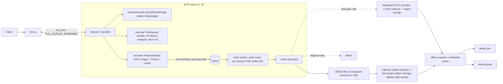
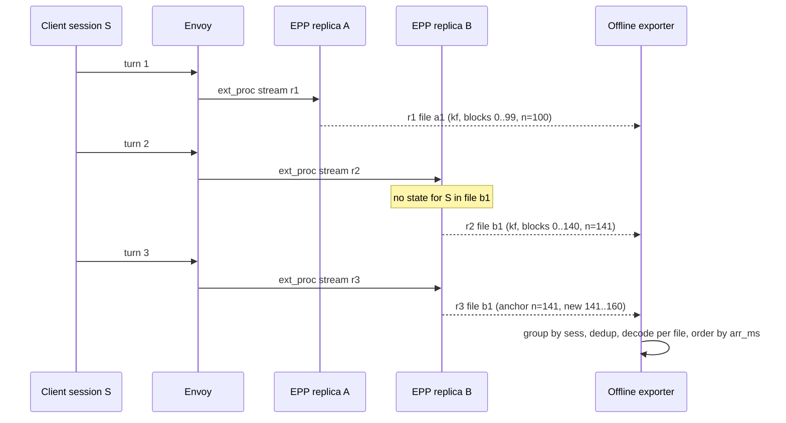

# EPP Weka Trace Recorder：在 llm-d-router 中采集无内容的 WekaTrace 负载数据

> [!IMPORTANT]
> **Problem**: llm-d 今天能用来做 agentic 负载优化的真实 trace 只有公开的 `semianalysisai/cc-traces-weka-061326`（183 个 Claude Code session），没有任何来自 llm-d 自身 dogfood / 客户集群的负载形状数据。
> **Proposal**: 新增 `weka-trace-recorder` EPP 插件，每个请求只写一条**无内容、按 session 派生密钥伪匿名**的扁平 shape record（异步、有界、永不让请求失败），由**离线 exporter** 跨副本合并成 aiperf 可直接加载的 WekaTrace v7；另外在 requestHandler 层新增独立开关 `injectStreamUsage`，注入并对客户端隐藏 `stream_options.include_usage`。
> **Impact**: 每个开启的集群都能产出可 replay 的 WekaTrace + llm-d 扩展 sidecar；开启注入后，EPP 自身的输出 token 指标与依赖 `CompletionTokens` 的插件对 OpenAI 流式请求从"恒为 0"变为准确。
> **Status**: v2（Review Round 1 后修订）；`global` hash scope 为 stretch goal；见 §8。

[TOC]

## 1. Summary

本文提出两件互相独立、可分别开启的改动。(1) **被动观察插件** `weka-trace-recorder`：在 `PreRequest` 与 `ResponseBody(EOS)` 两个 hook 上做 O(1) 记账，把 token 序列引用和标量字段交给有界异步 worker，worker 计算 64-token 链式 keyed hash 并写出一条 JSON 行。EPP 内**不保存任何决定正确性的 session 状态**；session 组装、子 agent 重建、稠密 `hash_ids` 重映射都在离线 exporter 中完成，因此单副本与多副本（active-active、leader-election 故障切换）走同一条路径。(2) **requestHandler 级 usage 注入** `injectStreamUsage: off|always`，让所有 OpenAI 流式请求都带服务器上报的 usage，由 handler 剥离注入产生的额外事件。记录器有两种 sink：本地文件 + collector，或通过独立 OTLP provider 发往集群内 OTel Collector（§4.11）；现有 OTel trace 不被替代，只通过 `otel_trace_id` 关联。读者需要记住的一个决定：**EPP 只产出"每请求事实"，WekaTrace 是离线投影**。

## 2. Problem Statement & Motivation

llm-d 的路由与服务优化（prefix-aware 调度、flow control 公平性、P/D 拆分、KV 分层）高度依赖负载形状：多轮会话的前缀复用率、子 agent 并发扇出、think time、输入/输出长度分布。当前唯一可直接 replay 的 agentic trace 是 SemiAnalysis 的 WekaTrace 数据集：183 sessions、44,990 requests、9.36B 输入 token，全部来自 Claude Code + Claude 模型。它无法回答"我们自己的 dogfood / 客户负载长什么样"。

EPP 是唯一同时看到**请求头（session 身份）、请求 body（token 化后的 prompt）、调度决策、响应 usage 与时序**的组件，但今天这些信息只以聚合指标形式存在（`pkg/epp/handlers/response.go:95-107`），无法 replay。

另外，OpenAI 流式请求在客户端未设置 `stream_options.include_usage` 时，EOS 处 `Usage` 为全零（EPP 从不注入，见 [`openai.go:594-606`](https://github.com/zetxqx/llm-d-router/blob/7eec9d9cce1ed5a32f376d6d17ecc4e0abccd59c/pkg/epp/framework/plugins/requesthandling/parsers/openai/openai.go#L594-L606)）。这同时让 trace 的 `out` 字段与 EPP 自身多个子系统失真（§4.4）。

### Impact

| 受影响方 | 现状 | 不改变的后果 |
| :--- | :--- | :--- |
| 路由/调度优化 | 只能用 Claude Code 公开 trace 做基准 | 优化针对的负载与真实部署不一致 |
| EPP 指标 | OpenAI 流式请求 `RecordOutputTokens / TPOT / NTPOT` 记录为 0 | 仪表盘和 SLO 误导 |
| 依赖 `CompletionTokens` 的插件 | `inflightload` token 估算、`sessionstate`、flow-control `program-aware/strategy_las.go` 拿不到真实输出 | 估算偏差、LAS 公平性把流式程序视为"零服务" |

## 3. Goals & Non-Goals

### Goals

- G1：导出文件**无需修改**即可被 aiperf Weka loader 加载（`extra="forbid"`、`hash_id_scope:"local"`、每 session 一个 `.json`、时间字段单位为秒）。
- G2：被采样 session 中 ≥ 99% 的已完成请求出现在导出中；丢弃全部可计数（指标），且任何单条 record 丢失最多影响同一文件内该 session 的后续 record。
- G3：开启 `injectStreamUsage: always` 时，≥ 99% 的已完成 OpenAI 流式请求有服务器上报的 `out`。
- G4：记录器 hook 在请求路径上的开销 p99 < 50 µs（`plugin_duration_seconds{plugin_name="weka-trace-recorder"}`）；注入走字节拼接路径时 p99 < 20 µs，回退到重新序列化时单独计量；记录器内存有硬上限（默认 ≤ 160 MiB = hash 队列 64 MiB + LRU 64 MiB + writer 队列 16 MiB + 未提交链值 16 MiB）。
- G5：记录器导致的请求失败数 = 0（不返回 error、hook 内 `recover`、密钥缺失即自禁用），且不会因本地磁盘导致 pod 被驱逐。
- G6：输出不含 prompt/completion 内容；`hash_ids` 抗字典/成员推断攻击，且不同 session 的 id 不可链接；客户集群数据不离开客户项目。
- G7：单副本（dogfood）与多副本（production：active-active 与 leader-election）均正确。

### Non-Goals

- 记录任何文本内容、tool 参数、header 原值。
- 在 EPP 内生成 WekaTrace 会话文件。
- v1 导出 `hash_id_scope:"global"`（stretch goal，§4.7）。
- 精确还原 Claude Code 的 `subagent_type / tool_use_count`（客户端不可控时不可观测，§4.6）。
- 记录在选 pod 之前就被拒绝的请求（v1 只计数，§8）。
- 运行时热切换开关：回滚通过滚动重启完成（§5，Residual dissent）。

## 4. Technical Design

### 4.1 System Architecture & Component Interactions



| 组件 | 职责 | 约束 |
| :--- | :--- | :--- |
| `injectStreamUsage` 步骤（requestHandler） | 见 §4.4；位于 `priorityRewriteIfNeeded` 之后、`repackage` 之前（`director.go:343-346`） | 与记录器无关，可单独开启 |
| 记录器 `PreRequest` | 读 session id（默认消费 `agent-identity` 属性，声明在 `Consumes()`），计算 `sess` 并按 `sess mod 10⁴ < rate·10⁴` 采样；保存 `TokenizedRequest` 切片引用、目标 endpoint、调度 profile；**永远 `return nil`** | PreRequest 返回 error 会使请求失败（`plugins.go:56-73`）；PreRequest 是 attribute-scoped，读取须在 `Consumes()` 声明（`director.go:704-710`）；token 切片此后无写者 |
| 记录器 `ResponseBody` | 中间 chunk 立即 return；EOS 时读取 `Usage`、`Timing`、`TerminationCause`，组装 record 并**非阻塞**投递 | EOS 同步执行（`director.go:636-646`） |
| hash worker（单 goroutine） | 64-token 链式 hash、每 session PRF、delta；**决定文件切换**并给每条 record 打上文件代号 `gen` | 每 session 把 `k_s` 吸收进 blake2s 状态一次，每块克隆状态，只做一次压缩、无分配；估计 150–300 ns/块，688k token ≈ 2–3 ms（Phase 0 微基准确认） |
| writer goroutine | 序列化与写文件/stdout；与 hash 分离，sink 卡住不会占满 hash 队列 | 写成功后才通知 worker 提交 LRU；收到 `gen` 过期的 record 时拒绝写入，并要求 worker 重新编码为 keyframe |
| 离线 exporter | 合并副本、去重、delta 解码、lineage、稠密重映射、写 Weka + sidecar | `cmd/weka-export/main.go`，沿用 `build-%` 目标 |

**Director 侧的额外成本**：只要配置了任意 `ResponseBodyProcessor`，director 就会为每个流式请求建立 goroutine、容量 100 的 channel 与 `sync.Map` 项，每个 chunk 分配一个 `*fwkrc.Response` 并做一次 channel send（`director.go:126-133,621,666-677`）。如果部署里原本没有 ResponseBody 插件，启用记录器会让**所有请求**（包括未采样的）付出这部分成本；§6 要求在插件开/关两种情况下测量。

**顺序与并发不变量**

1. 一个请求的 ext_proc 流只终止在一个副本上，因此每请求状态天然副本本地；session 跨副本只在离线合并。
2. record 只在 EOS 生成；只有 `TargetPod != nil` 的请求会收到 EOS（含 abort，`handlers/server.go:479-484`），其余由 `PluginState` 5 分钟 reaper 回收（`plugin_state.go:35`），记录器写入状态后调用 `BindLiveness(ctx, requestID)`。
3. 队列满、sink 写失败、`kid` 变化时：丢弃当前 record、计数、清空对应 session（或全部）的 LRU，下一条必为 keyframe。
4. 每个 hook 包一层 `defer recover()`：请求/响应路径上没有任何 `recover`（`director.go:706,737,850,861-865`），插件 panic 会导致副本退出。

### 4.2 API Contracts & Data Structures

**Framework 改动 1：`fwkrc.Response` 的 handler 时间戳**。director 在**每次** EOS 调用（包括 abort 路径 `server.go:484` 直接调用的情况）都填充；插件内 `time.Now()` 不可用于 TTFT，因为中间 chunk 是异步队列投递的（`director.go:596-600,648-656`）。`RequestContext` 新增导出访问器读取 `firstTokenTimestamp / responseCompleteTimestamp`（`server.go:166,168` 未导出）。

```go
// pkg/epp/framework/interface/requestcontrol/types.go
type ResponseTiming struct {
    RequestReceived     time.Time     // handlers/request.go:41
    FirstByte           time.Time     // zero if no body bytes were received
    Completed           time.Time     // director sets time.Now() when the handler left it zero (abort)
    FlowControlAdmitted bool
    FlowQueueWait       time.Duration // RequestContext.FlowControlQueueDuration
}
type Response struct {
    // ...existing fields...
    Timing *ResponseTiming // non-nil on every EndOfStream call, nil otherwise
}
```

**Framework 改动 2：`requestHandler.injectStreamUsage`**，与 `propagatePriority`（`apix/config/v1/endpointpickerconfig_types.go:373-377`）同级，默认 `off`；`RequestContext` 记录 `injectedUsage`（§4.4）。

**插件参数**（稳定性 `StabilityAlpha`，需要 `--allow-experimental-plugins`，`plugin/stability.go:22-29`）

| Name | Type | Required | Default | Description |
| :--- | :--- | :---: | :--- | :--- |
| `mode` | `dogfood \| customer` | 是 | — | 缺失为配置错误 |
| `consent` | bool | `mode=customer` 时是 | `false` | `customer` 且非 `true` 为配置错误（启动即可见） |
| `keySecretPath` | string | 是 | — | 文件缺失或不可读：插件**运行时自禁用**（`weka_trace_enabled=0`），请求路径不变 |
| `sampleRate` | float | 否 | `0.01` | 按 session 采样 |
| `sessionSource` | `{attribute \| header}` | 否 | `attribute: agent-identity` | 复用现有 session 解析，不重复 header 列表 |
| `modelAllowlist` | []string | 否 | `[]` | 其余模型名输出 `model-<PRF64>` |
| `sink.type` | `file \| otlp` | 否 | `file` | `otlp` 见 §4.11 |
| `sink.path` | string | 否 | `/var/weka-trace` | emptyDir 挂载点（`file`） |
| `sink.fileBytes` | quantity | 否 | `64Mi` | 单文件大小，满后切换新文件；记录器不删除文件 |
| `sink.diskHighWatermark` | quantity | 否 | `900Mi` | 目录总量超过后丢弃新 record |
| `sink.stdout` | bool | 否 | `false` | 仅 `mode=dogfood` 可为 `true` |
| `sink.otlp.endpoint` | string | `type=otlp` 时是 | — | 专用 OTLP endpoint（通常是集群内 OTel Collector）；所有传输选项显式设置，不继承全局 `OTEL_*` 环境变量（§4.11） |
| `sink.otlp.headers` | map | 否 | `{}` | 显式设置，防止继承 `OTEL_EXPORTER_OTLP_HEADERS` 中的 APM 凭证 |
| `sink.otlp.maxBatchBytes` | quantity | 否 | `1Mi` | 按字节组批，须小于 Collector 的 `max_recv_msg_size`（默认 4 MiB） |
| `sink.otlp.protocol` | `grpc \| http/protobuf` | 否 | `grpc` | 与 `telemetry.go:233-237` 的取值一致 |
| `sink.otlp.insecure` | bool | 否 | `false` | `mode=customer` 时必须为 `false` |
| `sink.otlp.keyframeEvery` | int | 否 | `16` | OTLP 模式下每 session 每 N 条强制 keyframe，限制 Collector 侧丢失的影响 |
| `linkOTelTrace` | bool | 否 | dogfood `true`，customer `false` | 请求被 OTel 采样时在 record 中写入 `otel_trace_id`（§4.11）；`OTEL_TRACES_EXPORTER=none` 时自动关闭 |
| `queue.maxBytes` | quantity | 否 | `64Mi` | hash 队列，含被引用 token 切片的字节数 |
| `writerQueue.maxBytes` | quantity | 否 | `16Mi` | writer 队列；未提交链值另有 16 MiB 上限，超过时按队列满处理 |
| `lru.maxBytes` | quantity | 否 | `64Mi` | 每 session 保存当前文件代号内最近一条已写出 record 的满块 id 列表（平均约 17.8 KB，64 MiB 约容纳 3.7k 个活跃 session；被淘汰的 session 下一条写 keyframe） |

错误分级：**配置错误**（`mode` 缺失、`consent` 不满足、`stdout` 用于 customer）由工厂返回，整个配置加载失败（`configloader.go:237-240`），部署时即可发现；**运行时问题**（密钥缺失、磁盘水位、队列满）只自禁用或丢弃并计数。

<details>
<summary>Shape record v1（每请求一行 JSON）</summary>

```json
{"v":1,"kid":"2026-10","rid":"<PRF64(eppRequestID)>","rep":"<PRF64(pod)>",
 "sess":"<PRF64 hex | null>","arr_ms":1792771200123,
 "api":"openai.chat","model":"meta-llama/Llama-3.1-70B-Instruct","stream":true,
 "tok_backend":"vllm","prompt_tok":142231,"blocks":2223,
 "anchor":{"n":2168,"h":"<PRF64 hex>"},"new":"<base64>","kf":false,
 "cached_tok":138752,"out_tok":250,"usage_src":"injected","events":251,
 "max_tokens":32000,"has_tools":true,
 "ttft_ms":5018,"api_ms":5396,"queue_ms":12,"status":200,"cause":"natural",
 "ep":"<PRF64(endpoint)>","profile":"decode",
 "otel_trace_id":"<32 hex | absent>","otel_trace_sampled":true}
```

- 所有时间字段为**毫秒**（原始层）；exporter 输出 Weka 时换算为秒。
- `blocks = ceil(prompt_tok / 64)`，包含不满 64 的尾块；不变量 `blocks == anchor.n + len(new_ids)`（keyframe 时 `anchor.n = 0`）。
- LRU 内容：每个 session 只保存**当前文件代号内最近一条已写出 record** 的满块 id 列表。编码时 `anchor.n` = 当前请求与该列表的最长公共满块前缀，`anchor.h` 为第 `n−1` 块的 id；公共前缀为 0（或 LRU 中没有该 session）时写 keyframe。`anchor` 只落在**满块**上。
- `kf:true` ⇔ `anchor` 缺省，`new` 含全部块。
- `new`：little-endian uint64 序列，RFC 4648 标准 base64。
- `tok_backend` 在启动时从 token-producer 配置解析（`TokenizedRequest` 本身没有 backend 字段，`requesthandling/types.go:211-218`），同时作为 `weka_trace_enabled{tok_backend}` 标签。
- `ttft_ms` 仅在 `stream=true` 且 `Timing.FirstByte` 非零时出现。
- `rid` 为 EPP 请求 UUID 的 PRF 值，用作去重键。不输出原始 UUID：客户端未带 `x-request-id` 时，EPP 把该 UUID 写入请求头（`handlers/server.go:530-535`），并作为 `gen_ai.request.id` 出现在现有 span 上（如 `tokenizer.go:441`），原值会成为与 trace 后端的直接 join 键。
- `otel_trace_id / otel_trace_sampled` 仅在 `linkOTelTrace: true` 时出现；在 `PreRequest` 中从 ctx 读取（该 ctx 携带 `request_orchestration` span，与 `request` span 同属一个 trace，`director.go:201`）并存入 `PluginState`（abort 路径的 EOS ctx 不含 span，`server.go:482-484`）。trace id 可能继承自客户端的 `traceparent`（`server.go:540-545`）。只进 sidecar，不进 Weka。
- 演进：读取方忽略未知字段；只有破坏性变化才提升 `v`。

</details>

**Hash 与密钥**：块大小固定 64 token（WekaTrace `block_size:64`），不设上限（现有 prefix producer 上限 131,072 token，[`approximateprefix/types.go:135`](https://github.com/zetxqx/llm-d-router/blob/7eec9d9cce1ed5a32f376d6d17ecc4e0abccd59c/pkg/epp/framework/plugins/requestcontrol/dataproducer/approximateprefix/types.go#L135)，且 hash 私有、PreRequest 后删除、block size 自动调优，不能复用）。

1. 链式 `c_i = xxhash(tokens_i, c_{i−1})`，`c_0` 的 seed 为 model + cache_salt，与 [`prefixhash/hashing.go:118-131`](https://github.com/zetxqx/llm-d-router/blob/7eec9d9cce1ed5a32f376d6d17ecc4e0abccd59c/pkg/epp/framework/plugins/requestcontrol/dataproducer/prefixhash/hashing.go#L118-L131) 语义一致。
2. 每 session 派生密钥 `k_s = PRF(k, "blk" ‖ session_id)`；输出 `id_i = PRF(k_s, c_i)` 截断为 64 位。
3. `sess = PRF(k, "sid" ‖ session_id)`（与 `k_s` 不同域）。
4. PRF 使用 `golang.org/x/crypto/blake2s` 的 keyed 模式（已是直接依赖，`go.mod:47`），不引入新模块。

同一 session 在所有副本上得到相同的 id（共享 `k`），不同 session 的相同内容得到不同 id。

**离线 exporter 输出**

| 输出 | 内容 | 约束来源 |
| :--- | :--- | :--- |
| `weka/<random-id>.json` | 每 session 一个 WekaTrace 对象：顶层 `id/models/block_size:64/hash_id_scope:"local"/requests`；`hash_ids` 重映射为每 trace 稠密整数 | aiperf 每文件一个对象、拒绝重复 `id`（`weka_trace.py:915-954`）；顶层 `models/block_size` 必填（`weka_trace_models.py:148-149`） |
| `totals` | trace 级 llm-d 扩展（副本数、token backend、usage 来源分布、lineage 置信度、`arrival_resolution_ms`：customer 模式为 100，即 `t` 与 `think_time` 可能有 ±100 ms 误差） | `totals: dict[str,Any]` 不校验（`weka_trace_models.py:163`） |
| `sidecar.jsonl` | 每请求扩展：`cached_tok`、`queue_ms`、`ep`、`profile`、`cause`、粗化到分钟的绝对到达时间、retry 标记 | 4 个 Weka model 都是 `extra="forbid"`（`weka_trace_models.py:24,61,100,145`） |

### 4.3 字段映射与语义差异

| Weka 字段 | 来源（exporter 换算为**秒**） | 与客户端代理采集的差异 |
| :--- | :--- | :--- |
| `id` | exporter 为每个 trace 生成随机 id | 不可回溯到 session header |
| `t` | `(arr_ms − 该 session 首个请求的 arr_ms) / 1000` | EPP 到达时间，不含客户端→网关网络；跨副本受时钟偏差影响（NTP 级，ms） |
| `model` | allowlist 内原样，其余 `model-<PRF64>` | LoRA 名称可能含客户名 |
| `in` | 精确 prompt token 数：`Usage.PromptTokens`，为 0 时用 token 化长度 | aiperf 接受 `in` 与块数不一致并截断尾块（`weka_prompt_compose.py:30-35`） |
| `out` | `Usage.CompletionTokens`；无 usage 时回退为 `events` 并在 sidecar 标记 | 需要 §4.4 注入 |
| `hash_ids` | §4.2 hash，exporter 稠密化 | 依赖真实 tokenizer；`tok_backend=estimate` 时 exporter 默认拒绝导出 |
| `api_time` | `(Completed − RequestReceived) / 1000` | **包含** EPP 排队与调度；排队单独在 sidecar 的 `queue_ms` |
| `ttft` | `(FirstByte − RequestReceived) / 1000`，仅 `type:"s"` 且 `FirstByte` 非零 | aiperf 只允许在 `s` 上出现（`weka_trace_models.py:88`） |
| `think_time` | `max(0, t_i − (t_parent + api_time_parent))`，parent 为 lineage 父请求 | 截断为 ≥ 0：aiperf 对子请求路径不做 0 下限（`weka_parallel_convert.py:449-450`）；默认模式只用 `Δt − api_time_prev`，因此 `t` 与 `api_time` 的精度更关键 |
| `type` | `stream ? "s" : "n"` | 已确认 `s`=streaming、`n`=normal（`weka_trace_models.py:29,66`） |

**观察者效应**：`api_time / ttft` 是采集时路由策略与负载的产物。replay 时应把 `t` 与 lineage 视为负载定义，把延迟视为当时策略下的观测值，而不是 ground truth。

### 4.4 `injectStreamUsage`：注入与剥离

**机制**

1. requestHandler 设置 `injectStreamUsage: always` 时，对满足全部条件的请求注入：parser 为 OpenAI chat/completions 或 completions；`Body.Stream == true`；请求中**没有** `stream_options.include_usage` 键。客户端显式设置 `include_usage:false` 视为客户端选择，不注入。Responses API 的 usage 恒在 `response.completed` 中，Anthropic Messages 流式本身就带 usage（`parsers/anthropic/anthropic.go:159-216`），都不需要注入。
2. **字节拼接优先**：当 body 未被修改（`Mutated == false`）且已解析的 `PayloadMap` 中没有 `stream_options` 键时（查 map，不扫描字节），发送前缀块 `{"stream_options":{"include_usage":true},` 后接 `RawBody[1:]`，不重新序列化也不复制整个 body（需要 `envoy.BuildChunkedBodyResponses` 接受多段切片，当前只接受单个连续切片，`chunking.go:31,54`）。启用 InferenceModelRewrite 的部署总会设置 `Mutated`（`director.go:382`），因此总走回退路径。其余情况才用 `MutatePayloadMap`（`requesthandling/types.go:153-163`），由 `repackage` 重新序列化（`director.go:418-423`），并计入 `usage_injection_remarshal_total`。
3. 注入后，服务器在 `[DONE]` 之前多发一个 `{"choices":[],"usage":{...}}` 事件。handler 在 `injectedUsage` 时使用一个**与 usage parser 共享的 SSE 行缓冲**：跨 ext_proc chunk 拼接不完整的行，只剥离由注入引起的最后一个 usage 事件。这包括 usage 与 `[DONE]` 落在同一 chunk、以及 EOS chunk 带残余字节的情况（`openai.go:598-603`）。除这一个事件外，转发给客户端的字节与未注入时相同。
4. 解析失败或未找到预期事件时，计入 `usage_strip_anomalies_total`，并原样转发剩余字节，宁可多给客户端一个事件，也不吞掉 `[DONE]`。

**后端兼容性**：vLLM 与 SGLang 接受 `stream_options`；其它后端须确认后才能开启。服务器端开启了 `--enable-force-include-usage` 的部署本来就有 usage，应保持 `off`。P/D 分块 decode 时，routing sidecar 会删除 `stream_options` 并总是合成一个不含 `cached_tokens` 的 usage 事件（`pkg/sidecar/proxy/decode.go:183-184,286-305`）。此时 `out` 可用，但 `cached_tok` 缺失，sidecar 记录 `cached_src:"missing"`。

**收益**

| 收益 | 受益方 | 依据 |
| :--- | :--- | :--- |
| trace 的 `out` 为服务器真实 token 数，而不是事件数近似（投机解码、多 token chunk 时事件数 ≠ token 数） | 本记录器、replay 保真度 | `fwkrc.Response.StreamedEvents` 文档 |
| EPP 输出 token、TPOT、NTPOT 指标对 OpenAI 流式请求从 0 变为真实值 | 运维仪表盘、SLO | `handlers/response.go:95-107` |
| in-flight token 估算在请求完成时用真实输出校正 | `inflightload` producer / `token-load-scorer` | `dataproducer/inflightload/token_estimator.go` |
| 会话级状态拿到真实输出长度 | `sessionstate` producer | `dataproducer/sessionstate/producer.go` |
| LAS 公平性按真实已服务 token 排序，流式程序不再被视为"零服务"。`always` 对所有请求一致生效，不会只让部分 session 显得"服务更多" | flow control `program-aware` | `fairness/program-aware/strategy_las.go` |
| 拿到 `prompt_tokens_details.cached_tokens`（服务器启用时），可直接评估 prefix-aware 路由的命中率 | 路由优化 | `requesthandling/types.go:826-833` |
| 为输出长度预测（`outlen-bucket`）与延迟预测器提供标签 | 预测类插件 | `requestheader/outlenbucket/README.md` |

**代价**：字节拼接路径每请求只增加一次 map 查找与一个前缀块（目标 p99 < 20 µs，与 body 大小无关）；回退的重新序列化在 MB 级 body 上估计为 ms 级，Phase 0 用 `BenchmarkSplice` 与 `BenchmarkRepackage`（100 KB / 1 MB / 3 MB）给出实测值并作为门禁；剥离过滤器给每个被注入的流增加一个行缓冲。

### 4.5 单副本与多副本



**可解码性规则**：(a) 每个文件中每个 session 的第一条 record 必为 keyframe，因此每个文件可独立解码，一个文件丢失只影响它自己；(b) writer 确认写入成功后 worker 才把该 record 提交到 LRU；(c) sink 写失败、队列丢弃、`kid` 变化时清空相应 LRU；(d) 文件切换由 hash worker 决定：worker 递增 `gen` 并清空 LRU，之后编码的 record 都带新 `gen`，writer 拒绝旧 `gen` 的 record 并要求重编码为 keyframe，因此 delta 永远不会落进与其 anchor 不同的文件；(e) collector 只上传已关闭的文件。

| 拓扑 | 行为 | 风险与处理 |
| :--- | :--- | :--- |
| 单副本（dogfood） | delta 体积约为全量的 1/41（实测 2,646 请求：平均 2,223 块/请求，仅 54.5 块是新的；17.8 KB → 436 B，base64 后约 580 B） | 重启或换文件 → keyframe |
| active-active（N 副本） | 采样决定与 `sess` 由共享密钥决定，跨副本一致。**revisit 模型**：session 回到某副本时，该副本写的是相对自己上次所见前缀的累积 delta。keyframe 数 ≈ 每 session 每副本每文件 1 条；delta 体积随 N 约线性增长 | 只有体积变化，正确性不受影响；Phase 2 门禁按实测 bytes/record 设定 |
| leader-election 故障切换 | 只有 leader 处于 ready（`cmd/epp/runner/health.go:85`）；新 leader 的 LRU 为空 → keyframe；旧 leader 排空期间的请求仍写 record | 离线按 `rid` 去重（collector 重复上传）；排空重叠的请求 `rid` 不同，属于真实请求 |
| 时钟 | `arr_ms` 为副本墙钟；所有时长用单调时钟 | 跨副本偏差只影响 `t` 的 ms 级精度；lineage 判定使用 `skew_tol`（默认 250 ms） |
| 密钥轮换 | Secret 只在启动时读取；轮换随滚动重启生效 | 滚动窗口内同一 session 会出现两个 `kid`，id 不可互通；exporter 按 `kid` 拆分并在 `totals` 标记；`kid` 不一致告警在 rollout 期间抑制（`kube_deployment_status_observed_generation` ≠ `metadata.generation`，或 generation 变化后 30 分钟内） |

### 4.6 子 agent 重建（客户端不可控）

Exporter 以 `sess` 分组，按 `arr_ms` 排序后建 lineage：

| 规则 | 输出 |
| :--- | :--- |
| 父请求选择 | 候选须满足 `arr_p + api_p ≤ arr_c + skew_tol`，且子请求**延续**父请求：匹配长度 ≥ 父请求满块数 − 1（容忍父请求的最后一个满块因尾部重写而变化），且 ≥ 2 块；在候选中按 (匹配长度, 结束时间最晚, `rid` 字典序) 选择 |
| 分叉 | 每个父请求最多一个延续，按子请求到达顺序贪心分配；首选父请求已被占用时依次尝试下一个候选，全部占用才开启新链（因此两个首 prompt 相同的并行子 agent 恰好成为两条链） |
| 包含该 session 首个请求的链 | 主链，`type` 来自 `stream` |
| 其它根链 | `type:"subagent"`，`agent_id:"agent_NNN"`（按首请求时间编号），`subagent_type:"unknown"`，`status` 由 `cause` 映射为 `completed / error / cancelled`，`models` 为该链模型集合；`duration_ms / total_tokens / tool_use_count` 置 null，aiperf 用内层 `api_time` 推导（`weka_trace.py:172-189`）；嵌套子 agent 展平为一层（`weka_trace_models.py:122-123` 只接受 `n/s`） |
| 上下文压缩 | 使用主链模型、开始时主链没有在途请求、且之后的请求都延续它的新根，标记为主链延续，并在 `totals.lineage` 记录启发式命中次数 |
| 重试 | 2 s 窗口内、同 `sess`、`hash_ids` 完全相同且前一条 `cause != natural` 或状态码为 429/5xx：保留最后一次，sidecar 标记 retry |
| 没有 session id 的请求 | 每请求独立密钥（`k_s = PRF(k, "blk" ‖ rid)`），各自成一个单请求 trace，不参与 lineage（§8 OPEN-Q1） |

**如果客户端可控**，可以通过请求头（或我们控制的客户端代理）拿到更多信息：

| 合作头 | 能补全的内容 |
| :--- | :--- |
| `x-agent-id`、`x-parent-agent-id` | 精确的子 agent 树与 `agent_id`，不再依赖 lineage 启发式 |
| `x-subagent-type` | `subagent_type` |
| `x-tool-use-count`、`x-turn-kind`（`user`/`tool_result`/`compaction`/`title`/`classifier`） | `tool_use_count`；区分人类 think time 与工具执行时间；复现 Weka 构建时的 classifier 过滤；精确识别上下文压缩 |
| `x-retry-attempt` | 精确的重试去重 |
| `x-client-send-ts` | 拆分客户端→网关网络时间，得到客户端感知延迟 |
| `x-cache-salt-scope` | 明确租户隔离边界，为 `global` scope 提供依据 |

这些头仍按 §4.8 处理：只记录枚举值或 PRF 值，不记录原值。

### 4.7 Stretch goal：`hash_id_scope: "global"`

**价值**：揭示跨 session 的前缀共享（共同的 system prompt、tool 定义），这正是评估 prefix-aware 路由与全局 KV 缓存层所需的信号。默认的每 session 密钥（§4.2）在设计上切断了这种链接。

**做法**：新增 dogfood-only 参数 `hashScope: epoch`（`mode=customer` 时为配置错误）。这时块 id 使用 epoch 级密钥 `PRF(k, c_i)`，跨 session 可比较。exporter 只给**出现在 ≥ k 个不同 session 中**的块分配全局 id（建议 k ≥ 5），其余块保持 trace 本地 id。使用不同 `cache_salt` 的租户天然不会链接（salt 进入 `c_0` 的 seed）。

**阻塞点**：aiperf 只接受 `hash_id_scope: Literal["local"]`（`weka_trace_models.py:150`），需要上游 aiperf 改动或单独的 loader；epoch 模式下原始层重新具备跨 session 成员推断能力，只适用于内部 dogfood。因此 v1 只输出 `local`。

### 4.8 Security & Privacy

**信任边界**：record 离开 EPP 进程即越过边界。进程内可以有原始 token 和 xxhash；进程外只能有 keyed PRF 值和白名单字段。

| 数据 | 处理 | 理由 |
| :--- | :--- | :--- |
| prompt / completion 文本、tool 参数 | 不记录 | — |
| 块 hash | 每 session 派生密钥 `PRF(k_s, c_i)`；exporter 再稠密化，Weka 导出的 `id` 与 `hash_ids` 不含 keyed 值（`model-<PRF64>` 与 sidecar 的 `ep` 仍为 PRF 值） | 无 key 的 xxhash 可被持有 tokenizer 与候选文本（如公开的 Claude Code system prompt）的人重算（`prefixhash/hashing.go:52,121-122`）；部署级单一密钥则会让"能读原始层且能发请求"的人提交候选文本后比对 id，每 session 密钥阻断这一路径 |
| session header | `PRF(k, "sid" ‖ id)`；导出时替换为随机 trace id | header 是原始 UUID（`agent_identity.go:128`），也存在于客户端日志中 |
| 模型 / LoRA 名 | 白名单原样，否则 `model-<PRF64>` | LoRA 名可能包含客户名；64 位输出防止碰撞，但 LoRA 名空间小时，持有密钥者可枚举，因此密钥访问需受控 |
| endpoint / pod | `PRF64`，只进 sidecar | 内部拓扑 |
| `cache_salt`、FairnessID、其它 header | 不记录 | — |
| 时间 | 原始层保留绝对 ms；Weka 导出只保留相对 `t`；sidecar 中的绝对时间粗化到分钟 | 降低关联风险 |
| 残余泄露 | 长度分布、时序、session 内前缀结构 | 明确接受并写入文档 |
| session id 伪造与低熵 | `k_s` 由客户端提供的 header 派生（`agent_identity.go:44-47,128`）：知道受害者 session id 的人可以伪造它，针对该 session 测试候选文本；低熵或共享的 `x-session-affinity` 值会退化为共享密钥 | 只能针对已知 id 的单个 session；文档说明，低熵 header 不应作为 `sessionSource` |

| 方面 | Dogfood | 客户集群 |
| :--- | :--- | :--- |
| 开启方式 | `mode: dogfood` | `mode: customer` + `consent: true`；不出现在任何默认 profile |
| 密钥 | 团队 Secret，随发布按月轮换 | 客户自有 Secret / KMS，不离开客户项目 |
| Sink | 文件 + collector，或 `otlp`；stdout 仅在日志库保留期 ≤ 90 天时允许 | 文件 + collector → 客户项目内对象存储；或 `otlp` 到客户自己的 Collector（TLS，且该 pipeline 只路由到客户存储，不进 APM/trace 后端）；**禁止 stdout**（OTel stdout 没有脱敏，所有字段都会进入中心日志，`docs/otel-json-stdout.md:19,23`） |
| 保留期 | 原始层 90 天 | 原始层 ≤ 30 天（bucket lifecycle） |
| 密钥销毁 | 到期销毁 PRF 密钥：之后无法再把新 record 与旧 record 关联，也无法验证候选文本；**不会**让已存的长度、时序、id 相等关系消失，这些依赖对象删除 | 同左 |
| 数据流出 | 团队内部 | 只有客户主动发起的导出，且导出只含稠密 id |
| 数据主体删除 | 按 session 定位需要原始 session id，记录中只有 PRF 值；依赖保留期到期删除 | 同左，由客户策略决定 |

上线前需要按组织流程完成隐私审查。

### 4.9 Operational Safety & Failure Domains

| 故障 | 检测 | 影响范围 | 恢复 |
| :--- | :--- | :--- | :--- |
| 记录器 hook panic | `weka_trace_panics_total` | 单个 record | hook 内 `recover`；请求不受影响 |
| hash worker 跟不上（超长 prompt 洪峰） | `weka_trace_queue_bytes`、`records_total{result="dropped_queue"}` | 被丢弃的 record；该 session 下一条强制 keyframe | 字节上限 64 MiB；降低 `sampleRate`（需滚动重启） |
| sink 写失败 / 卡住 | `records_total{result="dropped_sink"}`、writer 延迟 | 新 record | writer 与 hash 分离；LRU 未提交，下一条 keyframe |
| 磁盘接近上限（collector 积压） | 目录字节数、`records_total{result="dropped_disk"}` | 新 record | 超过 `diskHighWatermark` 丢弃新 record；emptyDir `sizeLimit: 1Gi` + pod `ephemeral-storage` request，保证不会因磁盘驱逐 EPP |
| collector 宕机或无法上传 | collector 导出最老未上传文件的年龄，> 30 min 告警 | 本地积压，随后丢弃新 record | 修复 collector；记录器从不删除未上传文件 |
| OTLP Collector 不可用（`otlp`） | `weka_trace_otlp_export_failures_total`、`records_total{result="dropped_otlp"}` | 导出失败的批次 | 批次失败时通知 worker 清空该批涉及 session 的 LRU；按字节有界、满则丢弃；显式重试（初始 1 s，最长累计 10 s）；Collector 确认后的丢失由 `keyframeEvery: 16` 限制影响范围 |
| 密钥 Secret 缺失 | 启动日志 + `weka_trace_enabled=0` | 无记录 | Secret volume `optional: true`，pod 正常启动，插件自禁用 |
| 两个副本 `kid` 不一致（非 rollout 期间） | `weka_trace_enabled{kid}` 标签数 > 1，rollout 期间抑制 | session 被拆分 | 统一 Secret 后滚动重启 |
| pod 终止 / 滚动重启 | `weka_trace_flush_dropped_total` | 队列中未落盘与未上传的 record | 保留现有 `preStop: sleep: 5`（等待 endpoint 摘除，`routerlib/templates/_deployment.yaml:174-180`；镜像为 distroless，不能用 exec hook）；在 SIGTERM 路径（`servingCtx.Done`）中有时间上限地 flush（≤ 20 s，在 130 s grace period 内，`_deployment.yaml:23`）；collector 用 native sidecar（`restartPolicy: Always` 的 initContainer，需要 Kubernetes ≥ 1.29），在 EPP 退出后完成最后一次上传 |
| usage 剥离异常 | `usage_strip_anomalies_total` > 0 告警 | 被注入的流式请求 | 原样转发剩余字节；设置 `injectStreamUsage: off` 并滚动重启 |
| 超长 prompt 的 token 切片被队列持有 | `weka_trace_queue_bytes` | 内存 | 队列按字节限额（688k token ≈ 2.7 MB/请求） |

**没有运行时开关**：EPP 配置只在启动时解析（`cmd/epp/runner/runner.go:832-847`），所有开关变化都需要滚动重启（每 pod 最长约 130 s）。因此 `injectStreamUsage` 的灰度必须从单副本 dogfood 开始（§5）。

### 4.10 Deployment

| 项 | 位置 | 变化 |
| :--- | :--- | :--- |
| emptyDir 与 Secret | `router.epp.volumes` / `volumeMounts`（`config/charts/routerlib/templates/_deployment.yaml:232-233,286-313`） | 新增 `weka-trace` emptyDir（`sizeLimit: 1Gi`）与 `optional: true` 的 Secret |
| ephemeral-storage | EPP 容器 `resources.requests` | 新增 `ephemeral-storage: 1Gi` |
| collector | routerlib 新增 `router.epp.traceCollector` 值，渲染为 native sidecar（Kubernetes ≥ 1.29）；只上传已关闭文件，上传成功后才删除，不在 emptyDir 中暂存其它数据；镜像与许可证由部署方指定 | 现有 chart 没有通用 extra-container hook |
| 终止 | EPP 容器 | 保留 `preStop: sleep: 5`；flush 在 SIGTERM 路径中完成（≤ 20 s） |
| 启动参数 | EPP | `--allow-experimental-plugins` |
| `sink.type: otlp` 时 | 不需要 emptyDir、ephemeral-storage 与 collector sidecar | 需要集群内 OTel Collector，配置见 §4.11 |

### 4.11 Sink 选项：文件 vs OTLP，以及与现有 OTel trace 的关系

**现有 OTel trace**：每个请求有 `request` server span（`handlers/server.go:545`）→ `request_orchestration`（`director.go:201`）→ 调度 profile / filter / scorer / picker / P/D / tokenizer / prefix cache 子 span（`scheduling/scheduler_profile.go:162-371`），属性包括每个 scorer 的分数、picker 的 top endpoints 与分数、P/D 原因、token 数（`common/observability/semconv/llm_d.go:194-399`）。采样默认 `parentbased_traceidratio` 0.1（`common/observability/tracing/telemetry.go:129-130`）。缺少 usage、TTFT、`stream` 与块 hash。

| 方案 | 做法 | 结论 |
| :--- | :--- | :--- |
| A. 直接扩展现有 trace 替代记录器 | 在 `request` span 上加 usage/ttft/hash 属性，沿用全局采样器与 exporter | ❌ 见 §7 |
| B. `sink.type: otlp` | 记录器的 hook、worker、PRF、delta 不变，writer 改为通过一个**独立的** TracerProvider 发出 | ✅ 作为第二种 sink |
| C. `linkOTelTrace` | record 中写入已采样请求的 `otel_trace_id/otel_span_id` | ✅ dogfood 默认开启 |

**B 的机制**

1. 独立 `sdktrace.TracerProvider`：不注册为全局 provider，采样器为 `AlwaysSample`（记录器已按 session 采样），复用 `go.mod` 中已有的 `otlptracegrpc / otlptracehttp`。**不继承全局环境**：OTLP exporter 会用 `OTEL_EXPORTER_OTLP_*` 填充未显式设置的字段（`telemetry.go:284-288`），因此 endpoint、headers、TLS/insecure、证书、timeout、compression、retry 全部显式设置；provider 使用 `sdktrace.WithRawSpanLimits`（属性值长度不限、属性数 ≥ 64），避免 `OTEL_SPAN_ATTRIBUTE_VALUE_LENGTH_LIMIT` 截断 `new`。单测在设置了冲突 `OTEL_*` 变量的环境中断言：记录器 endpoint 收不到全局 headers，`new` 未被截断，customer 模式下 insecure 仍为 false。断言对象必须是实际行为（测试 Collector 收到的 headers、实际建立连接所用的 TLS 凭据、实际导出的属性长度），而不是配置结构体，因为显式 TLS 选项与 `OTEL_EXPORTER_OTLP_INSECURE`、`WithRawSpanLimits` 与 `OTEL_SPAN_ATTRIBUTE_*` 之间的优先级依赖所 vendor 的 SDK 版本。
2. 每条 record 一个 span：名称 `weka_trace.record`，字段按下表映射为 `llm_d.epp.weka_trace.*` 属性（在 `common/observability/semconv/llm_d.go` 中声明常量，沿用现有 `llm_d.epp.<component>.<field>` 命名）。**属性是权威值**；span 的开始/结束时间取导出时刻，仅供参考，不等于请求时间（避免与业务 span 按时间对齐）。Resource 属性 `llm_d.signal=weka-trace` 供 Collector 路由。该 span 不设置 parent。去重键为 `rid` 属性，不是 span id。
3. **按字节组批**：SDK 自带的 BatchSpanProcessor 按 span 数限流，单条 record 最大约 115 KB（base64），默认批大小下会超过 Collector 接收上限。改用自定义 SpanProcessor：按字节累计，每批 ≤ `sink.otlp.maxBatchBytes`（默认 1 MiB，部署文档要求 Collector `max_recv_msg_size` ≥ 4 MiB），队列计入 writer 队列的 16 MiB，满则丢弃并计数，不阻塞 worker；每批导出结果同步回报 worker。
4. 可解码性：EPP 不知道 Collector 的文件边界，因此不使用按文件 keyframe（§4.5 规则 a/d），改为：批次导出成功后才提交 LRU，失败时清空相关 session；另按 `sink.otlp.keyframeEvery`（默认 16）强制 keyframe；离线 exporter 在同一 `rep` 的全部文件范围内解码。SIGTERM 时在 ≤ 20 s 内 flush，剩余未导出的 record 计入 `weka_trace_flush_dropped_total`。

<details>
<summary>record → OTLP 属性映射（前缀 <code>llm_d.epp.weka_trace.</code>）</summary>

| JSON 键 | 属性键 | 类型 | 备注 |
| :--- | :--- | :--- | :--- |
| `v`, `kid`, `rid`, `rep`, `sess` | `version`, `kid`, `rid`, `replica`, `session` | int / string | `sess:null` → 属性缺省 |
| `arr_ms`, `ttft_ms`, `api_ms`, `queue_ms` | `arrival_ms`, `ttft_ms`, `api_ms`, `queue_ms` | int64 | 毫秒；缺失即缺省 |
| `api`, `model`, `tok_backend`, `usage_src`, `cause`, `ep`, `profile` | 同名 | string | — |
| `stream`, `kf`, `has_tools`, `otel_trace_sampled` | 同名 | bool | — |
| `prompt_tok`, `blocks`, `cached_tok`, `out_tok`, `events`, `max_tokens`, `status` | 同名 | int64 | — |
| `anchor.n`, `anchor.h` | `anchor_n`, `anchor_h` | int64 / string | keyframe 时两者缺省 |
| `new` | `new_ids` | string | LE uint64 + 标准 base64 |
| `otel_trace_id` | `otel_trace_id` | string | 仅 `linkOTelTrace` |

</details>
5. Collector 配置（部署方负责）：用 routing connector 按 `llm_d.signal` 把该 pipeline **只**路由到对象存储/文件 exporter（OTLP JSON），不进 trace 后端；exporter 支持读取 OTLP JSON 文件。

| 对比 | `file` | `otlp` |
| :--- | :--- | :--- |
| EPP 本地磁盘 | emptyDir ≤ 1 GiB，需水位与驱逐防护 | 无 |
| 额外组件 | collector sidecar（K8s ≥ 1.29） | 集群内 OTel Collector（很多集群已有） |
| 终止时的数据 | 未上传文件由 native sidecar 收尾 | SIGTERM flush（≤ 20 s），剩余计数丢弃 |
| 可解码性粒度 | 按文件，丢失不跨文件 | 按 `keyframeEvery`，丢失最多影响该 session 后续 15 条 |
| 隐私边界 | 记录器直接控制落盘位置 | 取决于 Collector pipeline 配置，EPP 无法强制 |

**C 的价值与限制**：离线可以把 Weka trace 与当时的路由决策（scorer 分数、picker 选择、P/D 原因）join，用于离线评估新的路由策略。但现有 span 携带**原始** `llm_d.epp.fairness.id`（无显式 header 时即 agent-identity 的 session header，`tracing/attribution.go:119-155`，`director.go:248-256`），能访问 trace 后端的人通过 `otel_trace_id` 即可把 record 重新关联到原始 session，因此 customer 模式默认关闭。关闭后仍可能按"到达时间 + pod"关联，所以 customer 模式另有三条措施：(1) 前提条件：原始层与 trace 后端的访问列表不重叠，写入 consent 说明；(2) 原始层 `arr_ms` 粗化到 100 ms（时长字段不受影响）；(3) `rid` 为 PRF 值，记录 span 的时间取导出时刻。残余风险：低 QPS 时时间 + pod 仍可能唯一确定请求。

## 5. Rollout & Migration Strategy

### Phases & Feature Flags

- [ ] Phase 0：framework 改动（`Response.Timing`、`injectStreamUsage`、handler 剥离）与插件合入，默认关闭。门禁：`BenchmarkRepackage` 实测；剥离过滤器全部切分偏移单测通过；文件 golden fixture 测试通过。
- [ ] Phase 1：dogfood 单副本，`sampleRate: 1.0`，`injectStreamUsage: always`。进入下一阶段的条件：§6 往返保真测试通过；记录器 `plugin_duration_seconds` p99 < 50 µs；丢弃率 < 0.1%；`usage_strip_anomalies_total` = 0 持续 7 天。
- [ ] Phase 2：dogfood 3 副本 active-active，外加一次 leader-election 演练。条件：每个文件独立可解码；bytes/record 与 revisit 模型预测的偏差在 25% 以内；导出可被 aiperf 加载。
- [ ] Phase 3：客户集群 opt-in 预览（`mode: customer` + `consent: true`），默认文件 sink。条件：隐私审查通过，客户确认存储位置。客户选择 `otlp` 时额外要求：发送一条带已知标记的 canary record，确认它出现在客户存储中且**不出现**在 trace 后端中。
- [ ] Phase 4（stretch）：`hashScope: epoch` + `global`，仅 dogfood，依赖 aiperf 上游改动。

### Backward Compatibility & Data Migration

插件已注册，但默认配置里不启用；不配置时零行为变化。`Response.Timing` 是新增指针字段，现有插件不受影响。`injectStreamUsage` 默认 `off`。record 带 `v` 版本号，exporter 按版本解析。

### Rollback Strategy & Criteria

回滚手段统一为**修改配置后滚动重启**（每 pod 最长约 130 s）。

| 触发条件 | 阈值 | 动作 |
| :--- | :--- | :--- |
| 记录器 hook 延迟 | `plugin_duration_seconds{plugin_name="weka-trace-recorder"}` p99 > 50 µs 持续 15 分钟（`pkg/epp/metrics/llm_d_router_metrics.go:271-277`） | 降低 `sampleRate` 或移除插件 |
| 请求总延迟回归 | EPP 请求 p99 相对上线前 7 天基线增加 > 1 ms | 移除插件 |
| EPP CPU | 相对基线绝对值增加 > 5 个百分点 | 降低 `sampleRate` 或设置 `injectStreamUsage: off` |
| `weka_trace_panics_total` | > 0 | 移除插件并排查 |
| `usage_strip_anomalies_total` | > 0 | 设置 `injectStreamUsage: off` |
| 丢弃率 | > 1% 持续 15 分钟 | 降低 `sampleRate` |

### Operator runbook

1. 在 Helm values 中加入 §4.10 的 volume、Secret、collector 与 `--allow-experimental-plugins`；在 `EndpointPickerConfig` 加入 `weka-trace-recorder`（以及可选的 `requestHandler.injectStreamUsage: always`）。
2. 验证：`weka_trace_enabled{kid,tok_backend} == 1`，`tok_backend` 不是 `estimate`；`weka_trace_records_total{result="written"}` 增长；对象存储中出现文件。
3. 导出：`weka-export --in gs://<bucket>/weka-trace/ --out ./weka --sidecar ./sidecar.jsonl --since <date>`。
4. 回放：`aiperf ... --input-file ./weka`（Weka loader 读取目录中的 `*.json`）。

## 6. Verification Strategy

- **单元与集成测试**（`make test-unit`）：hash 确定性与 64-token 切块；每 session 密钥隔离；delta/keyframe 编码与解码往返；跨副本采样一致性；`recover` 包装；剥离过滤器（所有切分偏移、usage 与 `[DONE]` 同 chunk、客户端显式 `false`、非流式多 chunk）；`Response.Timing` 在 abort 路径非 nil；配置错误与自禁用的分级。
- **故障注入**：随机删除或截断文件、注入 sink 写失败、中途更换 `kid`，断言所有存活 record 都能解码，且损失不跨文件。
- **schema 测试**：PR CI 中用 Go golden fixture（`test/` 下）+ `DisallowUnknownFields` 的镜像结构体校验 exporter 输出（`ttft` 只出现在 `s` 上、子 agent 含 `models`、时间为秒、顶层 `block_size`）；nightly 或 `workflow_dispatch` 任务用固定版本的公开 aiperf 加载同一 fixture。
- **往返保真测试**：用 aiperf replay 公开 `cc-traces-weka-061326` 的子集打到开启记录器的 llm-d，导出后与输入 trace 对比。aiperf 按 `hash_id` 合成内容，所以前缀结构应当能被还原。验收：`in` 分布 KS 距离 < 0.05；每个 session 的前缀复用率误差 < 2 个百分点；子 agent 组数召回率 ≥ 90%；两个并行、prompt 相同的子 agent 加 ±50 ms 时钟偏差的合成 trace 能被正确拆分。
- **性能**：记录器 EOS 路径微基准 p99 < 50 µs；插件开/关两种情况下的 director per-chunk 分配与 goroutine 数；worker 在 688k token 请求上的吞吐 ≥ 2× 峰值采样 RPS；`BenchmarkRepackage` 与字节拼接对比。
- **可观测性**：`weka_trace_records_total{result}`、`weka_trace_queue_bytes`、`weka_trace_worker_seconds`、`weka_trace_keyframes_total`、`weka_trace_panics_total`、`weka_trace_usage_source_total{src}`、`weka_trace_sink_bytes_total`、`weka_trace_enabled{kid,tok_backend}`、`usage_injection_total{path=splice|remarshal}`、`usage_strip_anomalies_total`，以及 collector 的上传滞后。附 dashboard 与 runbook。

## 7. Alternatives Considered

### 在 EPP 内组装 WekaTrace session
- **Pros**：不需要离线工具。
- **Cons & rejection**：session 跨副本；会话长度无界导致内存无界；重启丢整段 session；子 agent 分类需要未来的请求。4 位 panel 成员一致否决。

### 复用 prefix producer 已算的 hash
- **Pros**：零额外 hash 开销。
- **Cons & rejection**：hash 存在插件私有状态中，PreRequest 后即删除（`approximateprefix/plugin.go:277,286`）；block size 自动调优；上限 131,072 token，而公开 trace 中最大请求为 688k token。

### 输出无 key 的原始 hash，离线再重映射
- **Pros**：EPP 内实现最简单。
- **Cons & rejection**：能读到 sink 或日志的人可以做字典/成员推断（`hashing.go:52`）；stdout 会进入中心日志 ACL。

### 部署级单一 PRF 密钥
- **Pros**：天然支持跨 session 共享分析（`global`）。
- **Cons & rejection**：能读原始层且能发请求的人可用记录器做跨 session/租户成员推断（Review Round 1，Seat 6）。改为默认每 session 密钥，epoch 密钥只作为 dogfood stretch 模式。

### 在 EPP 内分配稠密 id
- **Pros**：输出体积最小。
- **Cons & rejection**：需要跨副本共享 session 状态，违反 G7。

### 由记录器参数控制 usage 注入（v1 方案，含 `sampled`）
- **Pros**：一个插件配置即可。
- **Cons & rejection**：`sampled` 让采样 session 有真实 `CompletionTokens`、其余为 0，LAS 公平性会把采样 session 视为服务更多而降级；注入的收益（指标、`inflightload`）不应依赖部署记录器和密钥。改为 requestHandler 级 `off|always`。

### 直接扩展现有 OTel trace，替代记录器（§4.11 方案 A）
- **Pros**：复用现有 span 与 exporter；天然带上路由决策。
- **Cons & rejection**：全局采样是按 trace id 的 `parentbased_traceidratio`（`telemetry.go:129-130`），上游 `traceparent` 决定是否采样，同一 session 的不同轮次会被随机丢弃；改成按 session 采样会改变所有排障用户的行为；`hash_ids` 平均 17.8 KB、最大约 86 KB，常见 trace 后端对属性数量与长度有上限并会截断；trace 后端的访问权限与保留期面向运维，且已包含原始 session id，叠加块 hash 会抬高整个 tracing 管道的敏感级别。**采纳的折中**：OTLP 作为记录器的独立 sink（方案 B），并用 `otel_trace_id` 关联（方案 C）。

### 模型服务器侧日志（如 vLLM 请求日志）
- **Pros**：有真实 token 与 cache 命中信息。
- **Cons & rejection**：看不到 session、排队与路由决策；每个 pod 一份，需要跨 pod join；llm-d 无法统一控制。可作为 `cached_tokens` 的补充来源。

### 客户端侧代理（SemiAnalysis 的做法）
- **Pros**：保真度最高，能拿到子 agent 语义。
- **Cons & rejection**：客户端不可控。作为补充保留，见 §4.6 合作头。

### Do nothing
- **Pros**：零成本。
- **Cons & rejection**：继续只用 183 个 Claude Code session 来优化 llm-d；OpenAI 流式请求的输出 token 指标和依赖它的插件继续失真。

| Option | Complexity | Risk | Perf | Compat | Verdict |
| :--- | :---: | :---: | :---: | :---: | :--- |
| **Proposal：每请求 record + 离线组装 + requestHandler 注入** | 中 | 低 | 请求路径 O(1) | ✅ 默认关闭 | ✅ chosen |
| EPP 内组装 session | 高 | 高 | 内存无界 | ✅ | ❌ 多副本、无界状态 |
| 复用 producer hash | 低 | 中 | 最好 | ✅ | ❌ 私有、131k 上限 |
| 原始 hash | 低 | 高（隐私） | 好 | ✅ | ❌ 字典攻击 |
| 部署级单一密钥 | 低 | 高（隐私） | 好 | ✅ | ❌ 成员推断 oracle |
| EPP 内稠密 id | 中 | 高 | 好 | ✅ | ❌ 跨副本状态 |
| 记录器控制注入（含 sampled） | 低 | 中 | 中 | ✅ | ❌ LAS 偏斜、职责耦合 |
| 扩展现有 OTel trace（A） | 中 | 中（隐私） | 中 | ✅ | ❌ 采样单位、大小限制、隐私混合；改为 sink 选项 B + 关联 C |
| 服务器侧日志 | 中 | 中 | — | ✅ | ❌ 缺 session 与路由 |
| 客户端代理 | 低 | 低 | — | ❌ 客户端不可控 | ❌（作为补充） |
| Do nothing | - | 高（决策失真） | — | ✅ | ❌ |

## 8. Open Questions & References

### Open Questions

- **OPEN-Q1 没有 session id 的请求**：(Recommended) 每请求独立密钥、单请求 trace / 不记录 / 用首块前缀派生伪 session（会重新引入跨 session 链接）。
- **OPEN-Q2 选 pod 前被拒绝的请求**：(Recommended) v1 只计数；v2 通过新的错误路径 hook 输出 `rejected` record / v1 就新增 hook。
- **OPEN-Q3 `tok_backend=estimate`**：(Recommended) 照常记录，启动时告警，exporter 默认拒绝导出 `hash_ids`（`--allow-estimate` 覆盖）/ 记录器直接拒绝启动。
- **OPEN-Q4 上游 `plugin.Closer` 接口**：(Recommended) 作为独立 PR 提议，替代基于 `servingCtx.Done` 的 flush / 只用 `servingCtx.Done`。
- **OPEN-Q5 公开 aiperf 与 agentx-harness 分支的 Weka schema 是否一致**：(Recommended) Phase 0 用 nightly 任务确认；不一致时以公开版为准。
- **OPEN-Q6 `sink.type: otlp` 的落地顺序**：(Recommended) v1 只实现 `file`，`otlp` 在 Phase 2 后加入 / v1 同时实现两种 / 只实现 `otlp`。

### Related recommendations (out of scope)

- 现有 OTel span 在所有 span 上携带原始 `llm_d.epp.fairness.id`（`tracing/attribution.go:119-155`），默认即 session header 原值，客户集群开启 tracing 时存在隐私风险；建议单独提 issue，提供 hash/关闭选项。
- 在 `request` span 上补 GenAI semconv 的 `gen_ai.usage.input_tokens / gen_ai.usage.output_tokens` 与 `first_byte` 事件；与记录器无关，开启 `injectStreamUsage` 后数据准确。

### Residual dissent

- Seat 6 建议加入 fsnotify 监听的运行时 kill switch。owner 决定接受滚动重启作为唯一回滚手段（每 pod 最长约 130 s），以灰度顺序（单副本 dogfood 先行）和 `usage_strip_anomalies_total` 告警作为补偿。已知代价：剥离过滤器出错时，泄露给客户端的是 `{"choices":[]}` 事件，读取 `choices[0]` 的客户端会出错，每个 pod 的暴露时间最长约为一次滚动重启（约 130 s）。

### References

- Design panel synthesis：https://artifacts.corp.google.com/gtmNML79nW
- Review Round 1：https://artifacts.corp.google.com/0V0crs5pZi
- WekaTrace 数据集：https://huggingface.co/datasets/semianalysisai/cc-traces-weka-061326
- aiperf Weka loader（agentx-harness）：`//depot/google3/experimental/akt/benchmarks/agentx-harness/src/aiperf/dataset/loader/weka_trace_models.py`、`weka_trace.py`、`weka_parallel_convert.py`、`weka_prompt_compose.py`
- 相关代码：`pkg/epp/framework/interface/requestcontrol/plugins.go`、`pkg/epp/requestcontrol/director.go`、`pkg/epp/handlers/{server,response}.go`、`pkg/epp/framework/plugins/requestcontrol/dataproducer/prefixhash/hashing.go`、`requestheader/agentidentity/`、`pkg/sidecar/proxy/decode.go`、`apix/config/v1/endpointpickerconfig_types.go`
- `docs/peer-discovery.md`（active-active 拓扑）、`docs/otel-json-stdout.md`

### Appendix: Review Log

| Round | Date | Committee | Grill | Changes |
| :--- | :--- | :--- | :--- | :--- |
| 0 | 2026-10-22 | — | — | Draft v1（panel：epp-runtime、privacy-engineer、trace-fidelity、red-teamer、fact-checker） |
| 1 | 2026-10-22 | 0/6 LGTM（6 Needs Work） | 9/7/0 | v2：注入移到 `requestHandler.injectStreamUsage: off\|always`；每 session 派生密钥；按文件可解码的 delta；emptyDir sizeLimit 与 collector 删除语义；时间单位为秒、`in` 为精确值；abort 时 Timing；lineage 父请求选择；参数表与错误分级；CI 改为 Go golden fixture；部署与 runbook；接受滚动重启作为回滚手段 |
| 1b | 2026-10-22 | mini（Seat 4 re-review） | — | v2.1：文件切换由 worker 决定并用 `gen` 防止 delta 跨文件；LRU 定义统一；父请求必须被延续、每父最多一个延续；collector 只上传已关闭文件 |
| 1c | 2026-10-22 | mini（Seat 1、Seat 6 re-review：LGTM with comments） | — | v2.2：拼接改为 map 查找 + 前缀块，不复制 body；blake2s 每块成本改为 150–300 ns；内存预算拆分并纳入 writer 队列；flush 移到 SIGTERM 路径并保留 `preStop: sleep: 5`；native sidecar 需要 K8s ≥ 1.29；session id 伪造残余风险；kid 告警抑制定义 |
| 1d | 2026-10-22 | 3/3 mini LGTM with comments（Seat 1、4、6） | — | v2.3：LRU 定义与容量说明对齐；分叉时尝试下一个候选父请求 |
| 2 | 2026-10-22 | — | — | v2.4：新增 §4.11：`sink.type: otlp`（独立 TracerProvider + Collector 路由）、`linkOTelTrace` 关联现有 trace；§7 重写"扩展现有 OTel trace"备选；§8 新增 OPEN-Q6 与相关建议 |
| 2b | 2026-10-22 | mini（Seat 3、Seat 6：Needs Work） | — | v2.5：OTLP exporter 显式设置全部传输选项与 `WithRawSpanLimits`；按字节组批（≤ 1 MiB）；属性映射表与 `llm_d.epp.weka_trace.*` 命名；属性为权威值、span 时间取导出时刻；`rid` 改为 PRF 值；只记录 `otel_trace_id`+`otel_trace_sampled`；customer 模式 `arr_ms` 粗化与访问隔离前提；Phase 3 canary 门禁 |
| 2c | 2026-10-22 | 2/2 mini（Seat 3 LGTM，Seat 6 LGTM with comments） | — | v2.6：Phase 3 sink 表述统一；`totals.arrival_resolution_ms`；OTLP 隔离单测断言实际行为 |
